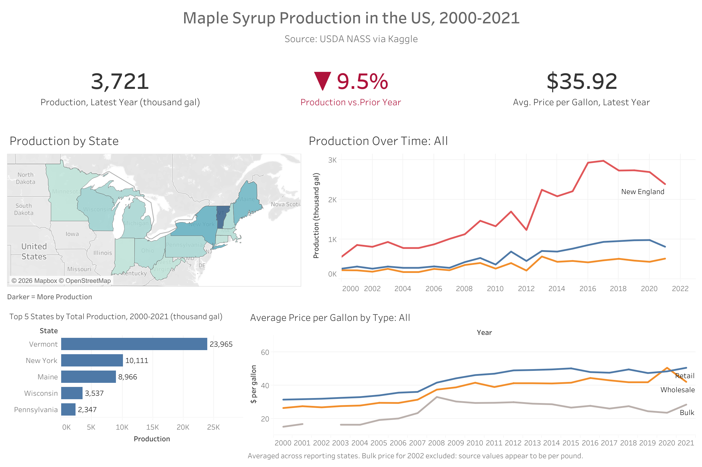

# US Maple Syrup Production Dashboard (2000-2021)
An interactive Tableau dashboard exploring 22 years of maple syrup production, yield, and pricing across 13 US states.

**[View the live dashboard on Tableau Public](https://public.tableau.com/views/USMapleSyrupProduction2000-2021/Dashboard1?:language=en-US&:sid=&:redirect=auth&publish=yes&showOnboarding=true&:display_count=n&:origin=viz_share_link)**



## Overview
This project analyzes how US maple syrup production and prices changed from 2000 to 2021. This dashboard was built to practice Tableau end to end: 
- Validating the data
- Creating calculated fields
- Building individual charts
- Assembling them into an interactive dashboard

**Questions that the dashboard answers**
- Which states produce the most syrup, and how has output changed over time?
- How did production in the latest year compare with the year prior?
- How have retail, wholesale, and bulk prices per gallon moved?

## Dataset
- **Source:** [Kaggle — Maple Syrup Prices](https://www.kaggle.com/datasets/datasciencedonut/maple-syrup-production-in-the-usa-2000-2021)
- **Records:** 220 records
- **Features:** 13 columns including State, Number of Taps, Average price per gallon, Retail price, and more
- **States:** 13 states across New England, Mid-Atlantic, and Midwest 

## Dashboard Features
- **KPI cards:** latest-year production, year-over-year change, and average price per gallon (these stay national and do not change with selections)
- **Production by state:** filled map shaded by production
- **Production over time:** line chart by region that updates when a state is selected
- **Top 5 states:** total production, 2000-2021
- **Price comparison:** retail, wholesale, and bulk price per gallon on one axis
- **Interactivity:** clicking a state on the map filters the trend and price charts; clicking empty map space resets them

## Key Findings
- **Vermont leads by a wide margin.** Its 2000-2021 total (about 24 million gallons) is more than double that of New York, the next largest producer.
- **Production grew through the 2010s.** Vermont's annual output rose from roughly 0.3 million gallons in 2000 to around 2 million gallons in its peak years.
- **The latest year was down.** 2021 production was 3,721 thousand gallons, a 9.5% decrease from 2020.
- **Prices rose, then leveled off.** Retail and wholesale prices per gallon climbed through about 2012 and have been roughly flat since. The latest-year average price was $35.92 per gallon.

## Tableau Techniques Used
- Calculated fields, including a weighted average price and year-over-year percent change
- LOD (Level of Detail) expressions
- Table calculations
- Parameters and sets (Top N)
- Measure Names / Measure Values for a multi-line chart on a shared axis
- Grouped fields (regions) used for color
- Dashboard filter actions
- KPI cards with conditional color and custom number formats

## Data Quality Notes
Validating the data surfaced several issues, and each was handled explicitly instead of patching values:
- **2002 bulk price per gallon.** Every state's `Bulk_G_Price` was between about $1 and $2, which matches the per-pound scale rather than the per-gallon scale seen in other years. These values were excluded, and the exclusion is noted in the dashboard caption.
- **2015 sap season dates.** Some states had a closing date before the opening date, and other 2015 season lengths were implausibly short. Season length is not used on the final dashboard.
- **Prices must be averaged, not summed.** Summing prices across states inflated the lines and made some years appear to collapse because fewer states reported. All price charts use averages.
- **Uneven state reporting.** Some smaller states report only a few years (Minnesota, for example, appears for 2016-2018 only), so their lines are short.

## Repository Contents
```
├── README.md
├── assets/
│   └── dashboard.png   # dashboard screenshot
└── data/ 
    └── Domestic_Maple_Syrup_Production_2000-2021.csv   # source data                 
```

## Author
**Aaron Thomas**
[LinkedIn](https://www.linkedin.com/in/aaron-s-thomas/) | [GitHub](https://github.com/aaronsthom)
